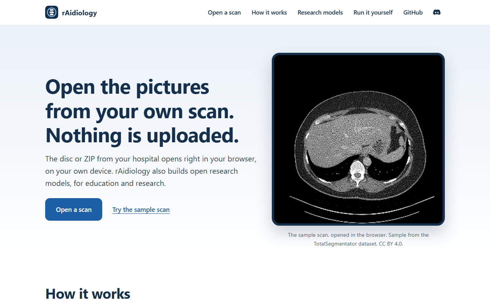

# rAidiology

A free, open-source viewer for medical scans that runs in your browser and on your own computer.

[](LICENSE) [](https://discord.gg/PsWpeNUzhk) 



> **Not a medical device.** For education and research, never for diagnosis.

## What you can do with it today

- Open the pictures from your own scan in your browser. Nothing is uploaded.
- Look at a sample reading in 3D: a glass body with the spine inside it.
- Read the cards of the research models, which say what each one does and does not do.
- Run all of it on your own computer.

## Run it on your own computer

You do not need to be technical.

1. Download the ZIP: [rAidiology-main.zip](https://github.com/LunarWerxs/rAidiology/archive/refs/heads/main.zip).
2. Unzip it anywhere.
3. Double-click the launcher for your computer:
   - Windows: `start-windows.bat`
   - Mac: `start-mac.command` (the first time, right-click it and choose Open)
   - Linux: `start-linux.sh`
4. Your browser opens on rAidiology.

It needs Python. If it is missing, Windows offers to install it for you. A Mac may ask to install its developer tools: say yes. Otherwise get Python from [python.org](https://www.python.org/downloads/).

To stop it, close the launcher window.

### For developers

```sh
git clone https://github.com/LunarWerxs/rAidiology.git
cd rAidiology
python reading/local/launcher.py   # the launcher
python serve.py                    # or just the bare site, caching off
```

The site in `site/` is static: no build step, no npm. Opening a page straight from disk does not work, because browsers block module loading from `file://`.

Model weights go in `models/<key>/`. The MCP server in [mcp/](mcp/README.md) lets your own AI read a scan on your own machine and leave behind a small file the viewer opens.

## Research models

These are research models. Their weights are coming as a gated download on Hugging Face. Each card says what the model reads, how it was tested and which data it used.

| Model | Reads | Status | Card |
|---|---|---|---|
| Fracture detector | X-ray of a wrist, hand, leg, hip or shoulder | Research model; weights coming on Hugging Face (version 1 already downloads from this repository's Releases page) | [card](release/cards/fracture-detector.md) |
| Disc grader | Lumbar spine MRI | Research model; weights coming on Hugging Face (version 1 already downloads from the Releases page as `disc-grader-v1`) | [card](release/cards/disc-grader.md) |
| CT segmenter | 3D CT scan | Research model; weights coming on Hugging Face | [card](release/cards/ct-segmenter.md) |
| Chest X-ray reader | Frontal chest X-ray | Research model; weights coming on Hugging Face | [card](release/cards/chest-xray.md) |
| Lung nodule finder | Chest CT | Research model; weights coming on Hugging Face | [card](release/cards/lung-nodules.md) |
| Mammogram reader | Mammogram | Research model; weights coming on Hugging Face | [card](release/cards/mammography.md) |
| Spine X-ray corner reader | Lumbar spine X-ray | Research model; weights coming on Hugging Face | [card](release/cards/spine-xray-corners.md) |

## How it is built

| Folder | What it holds |
|---|---|
| `site/` | the website, the in-browser scan opener and the 3D viewer; the data format is in `site/data/CONTRACT.md` |
| `reading/` | the local launcher and the reading tools |
| `core/` | parts every scan type shares: DICOM handling, image tools, paths |
| `modalities/` | one folder per scan type, with its pipeline, scorecard and model cards ([how one plugs in](modalities/README.md)) |
| `mcp/` | the MCP server ([mcp/README.md](mcp/README.md)) |
| `tools/` | repository tooling |

Datasets and trained weights sit beside the repository, never in it. The repository holds no patient data: `site/data/` has only a made-up sample. Anything you make from your own scan stays on your computer, and `.gitignore` keeps it out of commits.

## Contributing

Read [CONTRIBUTING.md](CONTRIBUTING.md). You sign the [CLA](CLA.md) once, by a comment on your pull request.

## Community

Join the [Discord](https://discord.gg/PsWpeNUzhk) or open a [GitHub issue](https://github.com/LunarWerxs/rAidiology/issues). Please do not post your own scans or health details in either place.

## Licence

[PolyForm Noncommercial 1.0.0](LICENSE). Free for personal use and for charitable, educational, public-research, public-health and government organisations. Commercial licences: contact at lunarwerx dot com. Third-party licences: [LICENSING.md](LICENSING.md).

Required Notice: Copyright (c) 2026 LunarWerx (https://github.com/LunarWerxs)

## Credits

- [TotalSpineSeg](https://github.com/neuropoly/totalspineseg) and [SpineReport](https://github.com/ivadomed/SpineReport) (NeuroPoly; LGPL-3.0): spine labels and measurements.
- [BodyParts3D](https://dbarchive.biosciencedbc.jp/en/bodyparts3d/) (DBCLS, CC BY 4.0): the reference skeleton, modified.
- [three.js](https://threejs.org/), pydicom, SimpleITK, nibabel, scikit-image, trimesh.
- The datasets behind each model, with the credit each asks for, are listed in its card.
