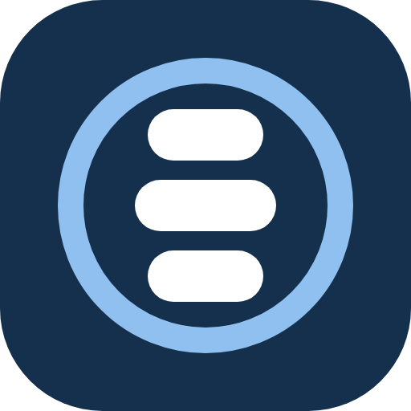
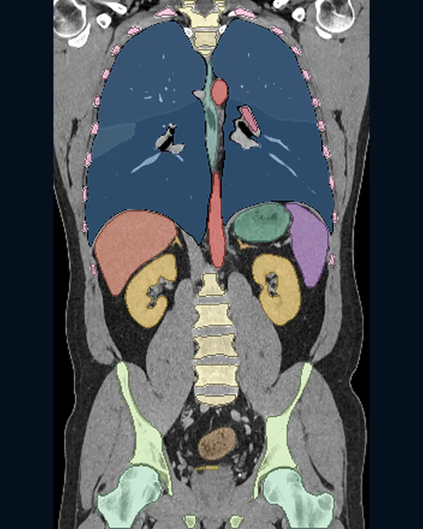
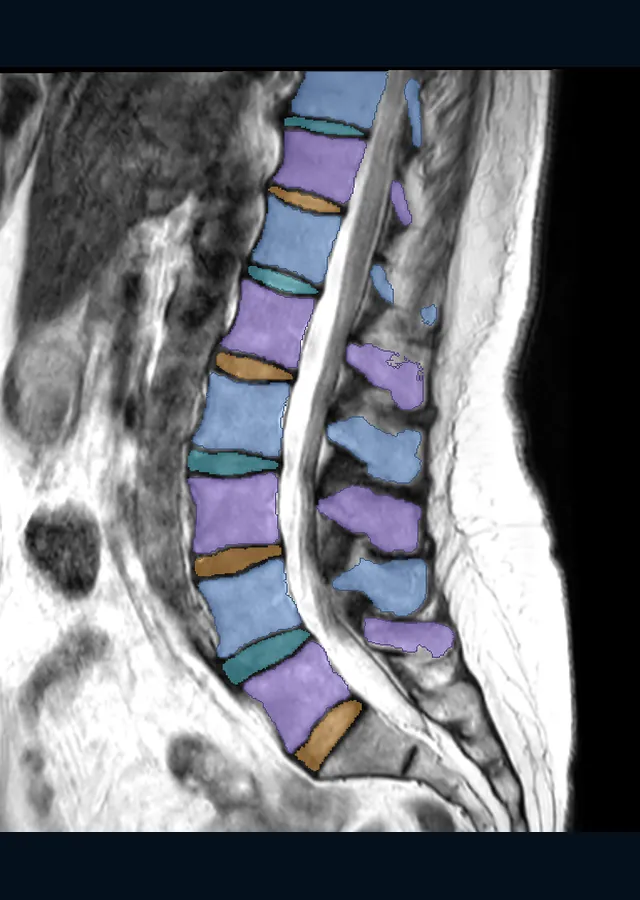
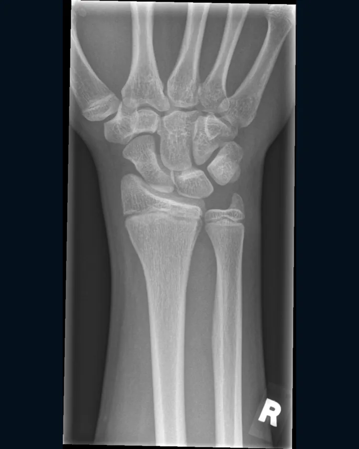
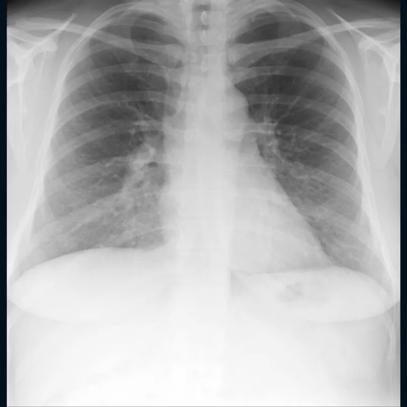
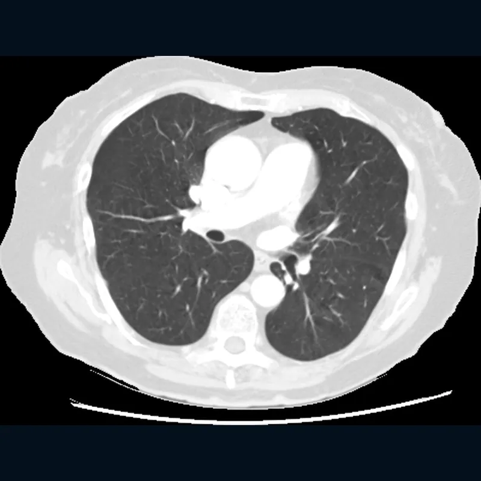
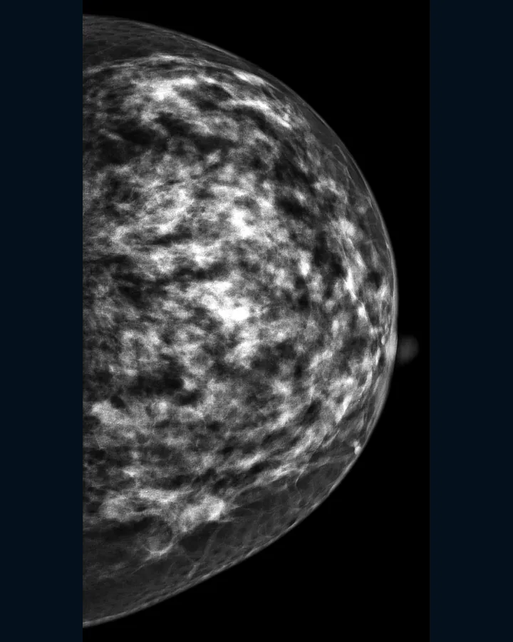
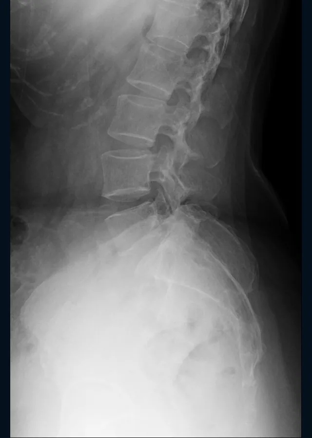

<p align="center">
  
</p>

<h1 align="center">rAidiology</h1>

<p align="center">A free, open-source scan viewer that runs in your browser, with seven open research models.</p>

<p align="center">
  <a href="LICENSE"></a>
  <a href="https://discord.gg/PsWpeNUzhk"></a>
  
</p>


## What it is

rAidiology is a scan viewer that runs in your browser. Open the pictures from your own scan and look through them, including a sample in 3D. Nothing is uploaded.

It also holds seven open research models, built for education and research. Each has a card that says what it was trained on, how it was tested and what it does not do.

## Scans it covers

<table>
<tr><td align="center" width="25%"><br><sub>CT, organs and bones coloured</sub></td><td align="center" width="25%"><br><sub>MRI of the lumbar spine, vertebrae and discs coloured</sub></td><td align="center" width="25%"><br><sub>X-ray of a child's wrist</sub></td><td align="center" width="25%"><br><sub>Chest X-ray</sub></td></tr>
<tr><td align="center" width="25%"><br><sub>CT of the chest, lung window</sub></td><td align="center" width="25%"><br><sub>Mammogram</sub></td><td align="center" width="25%"><br><sub>Side X-ray of the lower spine</sub></td></tr>
</table>

Pictures are from public datasets, shown with anatomy colours only. Dataset, licence and citation for each: [site/data/scan-pictures.json](site/data/scan-pictures.json).

## Research results

Each row is the headline result of one research model, with its 95% interval and the test set it was scored on. The full cards are in [release/cards/](release/cards/).

<!-- results:start -->
| Model | Scan | Measure | Result | Test set | Held-out or development |
|---|---|---|---|---|---|
| Chest X-ray research model | X-ray | AUROC: Agreement with ChestX-ray14's labels, mean over its 14 label types | 0.8175 (95% interval 0.811 to 0.8231) | NIH's official test list: 25,596 pictures of 2,797 patients | held-out |
| CT organ outliner | CT | Dice: Mean over 115 structures | 0.8668 (95% interval 0.8538 to 0.8781) | Held-out test: 89 CT scans | held-out |
| Disc grading research model (MRI) | MRI | kappa: Agreement with SPIDER's Pfirrmann grades, held-out test | 0.773 (95% interval 0.664 to 0.853) | SPIDER held-out test: 44 patients, 264 discs, opened once | held-out |
| Fracture research model (X-ray) | X-ray | AUROC: Agreement with GRAZPEDWRI-DX's fracture labels, children's wrists | 0.979 (95% interval 0.974 to 0.984) | GRAZPEDWRI-DX held-out test: 4,067 pictures of 1,176 patients with a certain label | held-out |
| Lung nodule research model (CT) | CT | share matched: Share of LUNA16's marked nodules matched, averaged over seven false-alarm allowances | 88.0% (95% interval 86.0 to 89.6%) | LUNA16: 888 thin-slice LIDC-IDRI scans, five folds, each read by a model that never trained on it | development |
| Mammogram research model | Mammogram | AUROC: Agreement with CMMD's benign/malignant labels, per picture | 0.793 (95% interval 0.774 to 0.811) | CMMD: 3,744 pictures of 1,775 patients, five folds split by patient | development |
| Lumbar spine X-ray corner reader | X-ray | share matched: Share of BUU-LSPINE's marked vertebrae matched, side view (IoU 0.5) | 97.9% (95% interval 97.3 to 98.4%) | All 2,000 BUU-LSPINE patients, out of fold | development |
<!-- results:end -->

Research results on public test data. Not a medical device. For education and research.

## Run it on your own computer

You do not need to be technical, and you do not run any file.

Install the app from the website linked in this repository's About box. Chrome and Edge show an Install button; on a Mac with Safari use File > Add to Dock; on iPhone and iPad use Share > Add to Home Screen; on Android use Install app. After the first visit it works offline, and nothing is uploaded.

For researchers: run `python reading/local/launcher.py` from the repository root. It serves the site on 127.0.0.1 and lists the research models.

### For developers

```sh
git clone https://github.com/LunarWerxs/rAidiology.git
cd rAidiology
python reading/local/launcher.py   # the launcher
python serve.py                    # or just the bare site, caching off
```

The site in `site/` is static: no build step, no npm. Opening a page straight from disk does not work, because browsers block module loading from `file://`. Model weights go in `models/<key>/`. The MCP server in [mcp/](mcp/README.md) lets your own AI assistant run the research models on your own machine; the viewer opens only the anatomy outlines it leaves behind.

## The research models

Weights are coming as a gated download on Hugging Face (disc grading research model version 1 already downloads from the Releases page as `disc-grader-v1`).

| Model | Scan | Card |
|---|---|---|
| Fracture research model (X-ray) | X-ray of a wrist, hand, leg, hip or shoulder | [card](release/cards/fracture-detector.md) |
| Disc grading research model (MRI) | Lumbar spine MRI | [card](release/cards/disc-grader.md) |
| CT segmenter | 3D CT scan | [card](release/cards/ct-segmenter.md) |
| Chest X-ray research model | Frontal chest X-ray | [card](release/cards/chest-xray.md) |
| Lung nodule research model (CT) | Chest CT | [card](release/cards/lung-nodules.md) |
| Mammogram research model | Mammogram | [card](release/cards/mammography.md) |
| Spine X-ray corner reader | Lumbar spine X-ray | [card](release/cards/spine-xray-corners.md) |

## Repository layout

| Folder | What it holds |
|---|---|
| `site/` | the website, the in-browser scan opener and the 3D viewer; the data format is in `site/data/CONTRACT.md` |
| `reading/` | the local launcher and the reading tools |
| `core/` | parts every scan type shares: DICOM handling, image tools, paths |
| `modalities/` | one folder per scan type, with its pipeline, scorecard and model cards ([how one plugs in](modalities/README.md)) |
| `mcp/` | the MCP server ([mcp/README.md](mcp/README.md)) |
| `tools/` | repository tooling |

Datasets and trained weights sit beside the repository, never in it. The repository holds no patient data: `site/data/` has only a made-up sample. Anything you make from your own scan stays on your computer, and `.gitignore` keeps it out of commits.

## How the site is built

The pages in `site/` are plain HTML, CSS and ES modules. The charts and the results table above are generated from `site/data/stats.json` by `release/site/build_charts.py` and `release/site/build_readme_table.py` (`--check` tells you if the table is out of date).

## Contributing

Read [CONTRIBUTING.md](CONTRIBUTING.md). You sign the [CLA](CLA.md) once, by a comment on your pull request.

## Community

Join the [Discord](https://discord.gg/PsWpeNUzhk) or open a [GitHub issue](https://github.com/LunarWerxs/rAidiology/issues). Please do not post your own scans or health details in either place.

## Support the research

Training runs today on one home graphics card. Rented data-centre GPUs train bigger models faster: at RunPod's listed prices (October 2026) an A100 80GB is $1.59 an hour, so $5 is about 3 hours, $15 about 9 hours and $50 about 31 hours. You can give once, [pay what you want from $3](https://buy.stripe.com/7sY9ATagDbjq5yC95l9Zm01), or monthly as a [Backer, $5](https://buy.stripe.com/dRm14nbkHfzG8KOftJ9Zm00), a [Supporter, $15](https://buy.stripe.com/bJeeVdewTgDK6CG95l9Zm02) or a [Sponsor, $50](https://buy.stripe.com/fZu9AT60n9bi6CGftJ9Zm03). The app stays free either way.

LunarWerx LLC is a for-profit company. Payments are not charitable donations and are not tax-deductible. Checkout is run by Connections Global LLC, LunarWerx LLC's authorised reseller, and Link is the merchant of record.

### Sponsors

No sponsors yet.

## Commercial licence

Any company or person using rAidiology's code or covered research models for commercial purposes, internal tools and testing included, needs a commercial licence. Personal use, and charitable, educational, public-research, public-health and government organisations, stay free under the PolyForm licence.

| Tier | Price | Allowance |
|---|---|---|
| Evaluation | free, 60 days | 500 studies in total; internal testing only |
| Startup | $1,500 a year | the Builder allowance, for a company under 3 years old that has raised under US$2M |
| Builder | $300 a month or $3,000 a year | 2,000 studies a month; 1 product or internal tool |
| Growth | $15,000 a year | 25,000 studies a month; up to 3 products or internal tools |
| Enterprise / OEM | from $30,000 a year, by agreement | higher volumes and distribution inside a product |

The 60-day evaluation is free, needs no sign-up and never turns into a paid plan by itself. Full terms are in [COMMERCIAL-LICENSE.md](COMMERCIAL-LICENSE.md).

Not for diagnosis or treatment. Not cleared by the FDA or any regulator.

Invoices, purchase orders, W-9 and annual terms: contact@lunarwerx.com

## Licence

[PolyForm Noncommercial 1.0.0](LICENSE). Free for personal use and for charitable, educational, public-research, public-health and government organisations. Commercial licences: see [Commercial licence](#commercial-licence). Third-party licences: [LICENSING.md](LICENSING.md).

Required Notice: Copyright (c) 2026 LunarWerx (https://github.com/LunarWerxs)

## Credits

- [TotalSpineSeg](https://github.com/neuropoly/totalspineseg) and [SpineReport](https://github.com/ivadomed/SpineReport) (NeuroPoly; LGPL-3.0): spine labels and measurements.
- [BodyParts3D](https://dbarchive.biosciencedbc.jp/en/bodyparts3d/) (DBCLS, CC BY 4.0): the reference skeleton, modified.
- [three.js](https://threejs.org/), pydicom, SimpleITK, nibabel, scikit-image, trimesh.
- The datasets behind each model, with the credit each asks for, are listed in its card.
